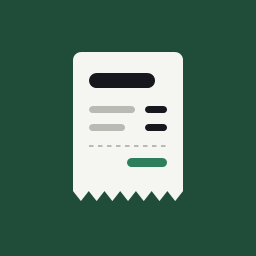
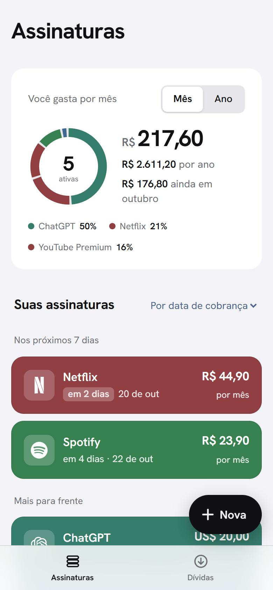
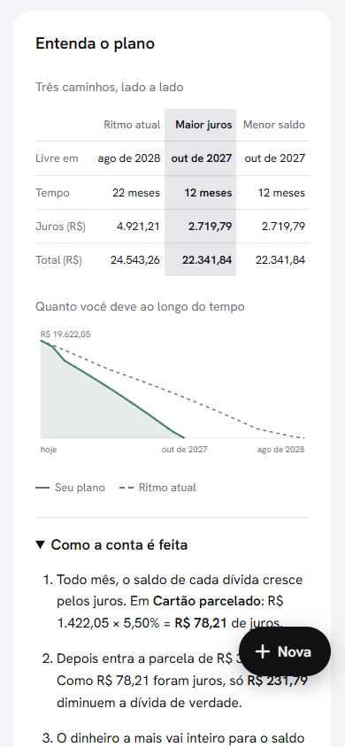
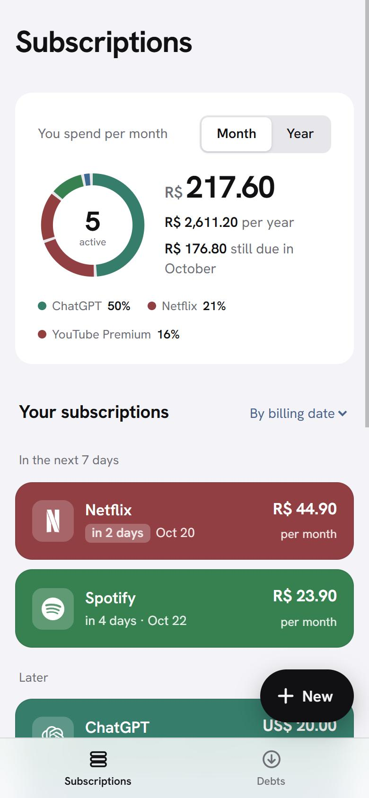
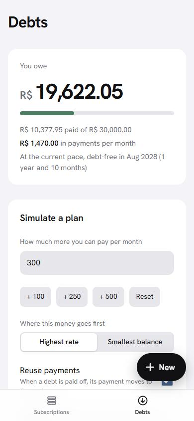
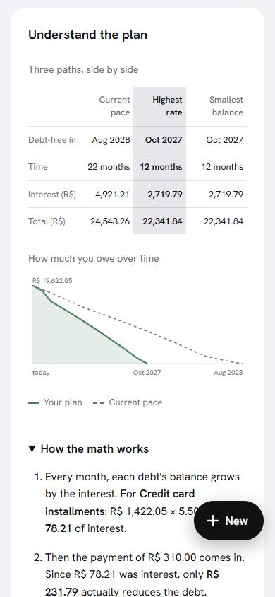

  

<h1 align="center">Minhas Assinaturas</h1>

  Quanto eu pago todo mês, quando cada cobrança vence e quando fico livre das dívidas.
   
  What I pay every month, when each charge is due and when I'll be debt-free.

  <a href="https://minhas-assinaturas.vercel.app"><strong>Abrir o app · Open the app →</strong></a>

---

## Português

  
  &nbsp;
  
  &nbsp;
  

Assinaturas · Dívidas · Plano de quitação — imagens com dados fictícios

### Assinaturas

Todas as assinaturas num só lugar, cada uma com o ícone e a cor da marca.

- Quanto você gasta por mês e por ano
- Quando vem a próxima cobrança, com destaque para as que vencem nos próximos dias
- Netflix, Spotify, iCloud, ChatGPT e mais de 40 serviços prontos, ou qualquer outra com foto própria
- Valores em real, dólar ou euro

### Dívidas

Um plano para sair das dívidas, com contas que você consegue entender.

- O saldo de cada contrato cai sozinho a cada mês
- A data em que cada dívida termina
- Simulação com um valor extra por mês, 13º, férias ou saque-aniversário
- Comparação entre caminhos para pagar menos juros
- Gráfico e explicação passo a passo, com os seus números

### No seu celular

Funciona no navegador e pode ser instalado na tela inicial, como um aplicativo. Abre rápido e mostra a última lista mesmo sem internet.

### No seu idioma

O app inteiro está disponível em português e em inglês. Dá para trocar com um toque na tela de entrada ou no fim da tela principal.

### Seus dados

Cada pessoa entra com o próprio e-mail e só vê os próprios dados. Dá para excluir a conta e tudo o que foi guardado a qualquer momento, direto pelo app. Mais detalhes na [página de privacidade](https://minhas-assinaturas.vercel.app/privacidade.html).

---

## English

  
  &nbsp;
  
  &nbsp;
  

Subscriptions · Debts · Payoff plan — screenshots with sample data

### Subscriptions

All your subscriptions in one place, each with the brand's icon and color.

- How much you spend per month and per year
- When the next charge comes, highlighting the ones due in the next few days
- Netflix, Spotify, iCloud, ChatGPT and 40+ ready-made services, or any other with your own photo
- Prices in reais, dollars or euros

### Debts

A plan to get out of debt, with math you can actually follow.

- Each contract's balance goes down on its own every month
- The date each debt ends
- Simulations with an extra monthly amount, a 13th salary, vacation pay or an FGTS withdrawal
- Comparison between paths to pay less interest
- Chart and step-by-step explanation, with your own numbers

### On your phone

Works in the browser and can be installed on the home screen, like an app. Opens fast and shows your last list even offline.

### In your language

The whole app is available in Portuguese and English. Switch with one tap on the sign-in screen or at the bottom of the main screen.

### Your data

Each person signs in with their own email and only sees their own data. You can delete the account and everything stored at any time, right from the app. More details on the [privacy page](https://minhas-assinaturas.vercel.app/privacy.html).

---

© 2026 Minhas Assinaturas · Todos os direitos reservados · All rights reserved

